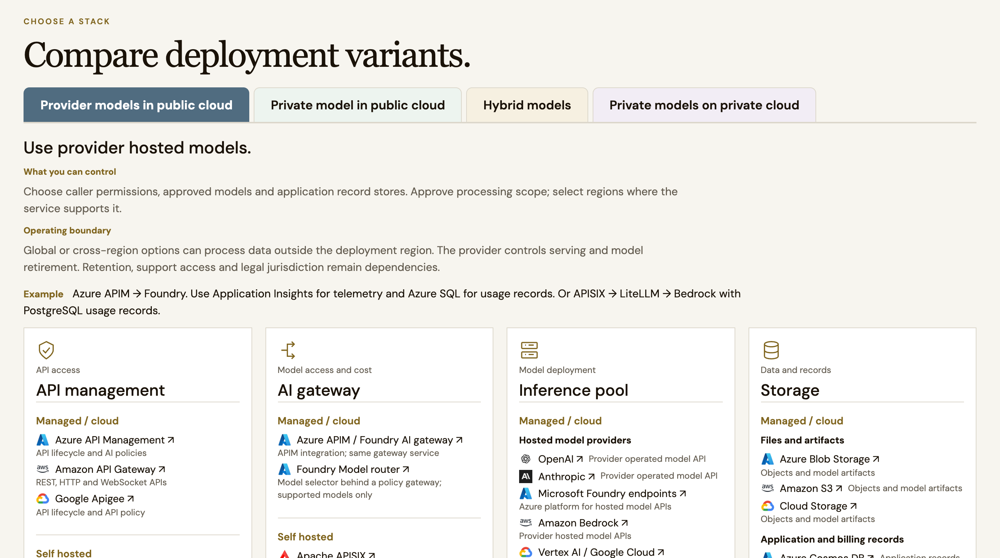
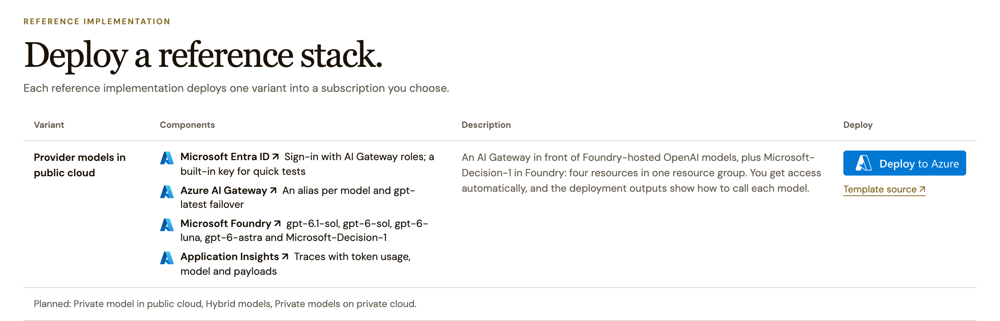

# Frontier models on public cloud (Azure)

[](https://portal.azure.com/#create/Microsoft.Template/uri/https%3A%2F%2Fraw.githubusercontent.com%2Fsharatsc%2Fsovereign-ai-infra%2Fmain%2Fprovider-models-public-cloud%2Fazure%2Fazuredeploy.json/createUIDefinitionUri/https%3A%2F%2Fraw.githubusercontent.com%2Fsharatsc%2Fsovereign-ai-infra%2Fmain%2Fprovider-models-public-cloud%2Fazure%2FcreateUiDefinition.json)

This template is the reference implementation of the **frontier models on public
cloud** variant from the Sovereign AI briefing. Applications call provider-hosted
frontier models in Microsoft Foundry through one AI Gateway endpoint. The gateway controls
access and traces every call.

It follows Azure-Samples [AI-Gateway `aigw-foundry-models`](https://github.com/Azure-Samples/AI-Gateway/tree/main/labs/aigw-foundry-models)
and [simple-foundry-hosted-agent-python-aigateway](https://github.com/Azure-Samples/simple-foundry-hosted-agent-python-aigateway),
scoped to model access in one resource group. The button opens a portal form with a
model checklist, one capacity setting and access options.

## Where it fits

The Sovereign AI briefing compares three deployment variants. This template implements
the first, **frontier models on public cloud**: provider-operated models behind a
gateway you control.



The briefing's reference implementation section links to this template:



## What it deploys

| Resource | Purpose |
|---|---|
| AI Gateway (Premium, preview) | One endpoint for all models, Entra ID access control, aliases with failover |
| Connector gateway with the same name | Pairs the gateway with the [AI Gateway portal](https://ai.gateway.azure.com/ai-gateways) |
| Azure AI Services account (Foundry) | Model deployments; local keys disabled, so only the gateway and Entra callers reach it |
| Application Insights | Gateway traces |
| Log Analytics workspace | Storage for the traces |
| Workbook "Start here" | Landing page in the Azure portal: live models, token usage, failures and links |
| Cost Management budget | Monthly budget with alerts at 80% actual and 100% forecast spend |

Default models:

| Provider | Deployments | Reached through |
|---|---|---|
| OpenAI | gpt-6.1-sol, gpt-6-sol, gpt-6-luna, gpt-6-astra | AI Gateway |
| Microsoft | Microsoft-Decision-1 (preview), deployed as `decision-1` | AI Gateway, `/systemone` passthrough |

Every gateway model gets an alias with its own name, and `gpt-latest` fails over from
gpt-6.1-sol to gpt-6-sol. Decision models use their own protocol, so the gateway
passes `/providers/microsoft/v1/systemone` through to Foundry unchanged.

## Use the deployment

Azure has no redirect after a deployment, so the template gives you two landing pages:

- **Start here workbook** (the `startHere` output). It is in the resource group's resource
  list and under its **Workbooks** menu. It lists the models you can call, read live from
  the gateway, and charts tokens, calls and failures from Application Insights. Its buttons
  open the next-steps page, the gateway's access control, traces, cost analysis, Foundry and
  the AI Gateway portal.
- **Next-steps page** (the `nextStepsUrl` output). It has ready-to-run calls for every model
  and links for this deployment.

If you start from the Deploy to Azure button on the Sovereign AI briefing site, the site
follows the deployment and opens the next-steps page when it finishes. Its **Your
deployments** page lists the deployments you started.

### Deployment status reports

To make that work, the template reports to the briefing site twice: when the deployment
starts and when everything else has finished. Azure fetches the `reportUrl` as an empty
linked template, so no extension or script runs in your subscription. Each report sends
the tenant, subscription, resource group and deployment names, the deployer's Entra
object ID and, at the end, the next-steps values (gateway URL, model names and resource
IDs). No keys or secrets are sent. The site shows each person only the deployments whose
object ID matches their own sign-in.

To turn reports off, clear **Report deployment status** in the portal form, or set
`reportUrl` to an empty string. If the site can't be reached, the report step fails the
deployment, so turn reports off for deployments that must not depend on it.

The deployment's **Outputs** in the Azure portal list everything a consumer needs:

| Output | Use |
|---|---|
| `chatCompletionsUrl`, `responsesUrl` | OpenAI Chat Completions and Responses endpoints on the gateway |
| `gatewayModelNames` | Values for the request's `model` field |
| `tokenAudience` | Audience for the Entra ID access token |
| `tryIt` | A ready-to-run curl call with an Entra token |
| `getApiKeyCommand`, `tryItWithKey` | Read the built-in test key and call with it |
| `decisionUrl`, `decisionModelNames` | Decision model endpoint on the gateway |
| `nextStepsUrl`, `startHere` | Next-steps page and the Start here workbook |
| `aiGatewayPortalUrl`, `azurePortalUrl` | Where to manage the gateway |
| `grantAccessCommand` | Give another user, group or app access |

Call a model with Entra ID, the recommended way:

```bash
TOKEN=$(az account get-access-token --resource https://azure-api.net/aigateway --query accessToken -o tsv)
curl -s "<chatCompletionsUrl>" \
  -H "Authorization: Bearer $TOKEN" -H "Content-Type: application/json" \
  -d '{"model":"gpt-latest","messages":[{"role":"user","content":"Hello"}]}'
```

Call a decision model:

```bash
curl -s "<decisionUrl>" \
  -H "Authorization: Bearer $TOKEN" -H "Content-Type: application/json" \
  -d '{"model":"decision-1","state":"The API returns 500 on every call.",
       "questions":{"team":{"type":"choice","instructions":"Which team should handle this ticket?",
       "criteria":{"billing":"Charges and refunds","engineering":"Bugs and outages","support":"How-to questions"}}}}'
```

The account that ran the deployment can call immediately. Grant others the
**AI Gateway User** role with `grantAccessCommand`, or the `principalId` parameter.

### Test with an API key

Every AI Gateway has a built-in `master` key with access to all models. Use it for
quick tests only; Microsoft recommends Entra ID for production callers. Read it with
`getApiKeyCommand`, or in the [AI Gateway portal](https://ai.gateway.azure.com/ai-gateways)
under **Access > Keys**, and send it in the `Api-Key` header (not `Authorization`).

### Manage the gateway

The AI Gateway portal at <https://ai.gateway.azure.com/ai-gateways> lists the gateways
you can access. It finds gateways through their connector gateway, which the template
creates. Select this one once; the portal remembers your choice. It has no link that
opens a specific gateway directly. `azurePortalUrl` opens the gateway
resource in the Azure portal.

## How access works

- **Inbound.** Callers use an Entra ID token for `https://azure-api.net/aigateway` and
  need an AI Gateway role: AI Gateway User, AI Gateway Models User or AI Gateway Tools
  User. The built-in key is for testing.
- **Outbound.** The gateway reaches Foundry with its system-assigned managed identity,
  which holds the Foundry User role. No provider keys are stored.

## Traces

Every call produces a trace in Application Insights: the inbound request, the
outbound Foundry call and the managed identity token request, linked by operation ID.
Payload capture is on by default because the gateway records token usage
(`gen_ai.usage.input_tokens`, `gen_ai.usage.output_tokens`) and the serving model
(`gen_ai.response.model`) only when it captures payloads. Captured traces include
request and response bodies, so prompt and completion text is stored in Application
Insights. Turn `payloadCapture` off if your data policy forbids that; traces then keep
timing, status and sizes but report zero tokens.

```kusto
requests
| where name has "/default/models/"
| project timestamp, name, resultCode, duration,
          model = tostring(customDimensions["gen_ai.response.model"]),
          inputTokens = toint(customMeasurements["gen_ai.usage.input_tokens"]),
          outputTokens = toint(customMeasurements["gen_ai.usage.output_tokens"])
| order by timestamp desc
```

## Before you deploy

- You need Owner, or Contributor plus User Access Administrator, on the target
  resource group. The template creates role assignments.
- Pick East US 2 or Sweden Central, where AI Gateway is in preview.
- Check Global Standard quota for each model in that region. Lower the capacity, or
  deselect models, if quota is short.

## Deploy with the Azure CLI

```bash
az group create -n rg-sovai-provider-cloud -l eastus2
az deployment group create -g rg-sovai-provider-cloud -f main.bicep
```

Optional parameters: `selectedModels` (for example `["gpt-6.1-sol","decision-1"]`),
`capacityOverride`, `principalId`, `payloadCapture`, or a custom `models` list.
`azuredeploy.json` is compiled from `main.bicep`:

```bash
az bicep build -f main.bicep --outfile azuredeploy.json
```

## Add Claude models

Add entries with `format: Anthropic` to `models`, for example
`{ "name": "claude-sonnet-5-5", "format": "Anthropic", "version": "2", "capacity": 20 }`,
and set `organizationName` (plus `industry` and `countryCode` if the defaults don't
fit). Foundry sends these three values to Anthropic.

The subscription must be able to buy the Anthropic offer in Azure Marketplace. If a
deployment fails with `MarketplaceSubscriptionCannotBeCompleted`, ask Microsoft to
allowlist the subscription. Claude models are called with the Anthropic Messages
protocol at `<aiGatewayEndpoint>default/models/anthropic/v1/messages`.

## Preview status

AI Gateway is in public preview. Preview services have no SLA, and their APIs and
pricing can change. Review the preview terms before production use.
